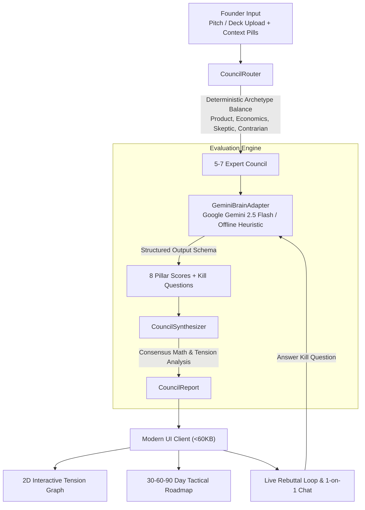

# QUORUM

> **Adversarial Pre-Mortem Co-Pilot Agent for Early-Stage Founders**  
> *Stress-test your startup thesis before writing a single line of code.*

---

## The Problem

Over 90% of early-stage startups fail—not because founders lack technical ability, but because they build things customers do not urgently need. Friends and mentors give polite encouragement, and standard AI assistants offer flattering validation. By the time reality hits, the founder has spent months and burned their savings.

**QUORUM eliminates this polite lie.** It simulates a Silicon Valley pre-mortem council: convening a panel of 5 to 7 adversarial domain icons grounded in 500+ curated expert philosophies across 30+ sectors. Instead of generic praise, QUORUM evaluates your pitch across 8 fundamental pillars, surfaces fatal existential risks, and challenges you with a lethal "kill question" per expert.

---

## Target Vertical

- **Student Builders & Hackers**: Validating project ideas before committing academic or semester resources.
- **Solo Founders & Bootstrappers**: Stress-testing customer acquisition payback and distribution wedges on limited budgets.
- **Pre-Seed & Angel Pitchers**: Discovering existential objections before entering formal investor meetings.

---

## System Architecture & Data Flow



---

## Core Logic & Methodology

### 1. The 8 Evaluation Pillars
Every expert evaluates the startup across 8 standardized dimensions (scored 0.0 to 10.0):
1. **Market Demand**: True customer urgency vs. "nice-to-have" luxury.
2. **Differentiation**: Defensibility against incumbents and copycats.
3. **Feasibility**: Technical and operational complexity to launch.
4. **Financial Viability**: Unit economics, margins, and payback horizon.
5. **Execution Risk**: Operational bottlenecks, founder dependency, and hiring hurdles.
6. **Regulatory & Legal Risk**: Compliance, platform dependency, and liability.
7. **Market Timing**: Why now? Technological or behavioral tailwinds.
8. **Defensibility & Scale**: Moats, network effects, and switching costs.

### 2. Consensus Tension Math
QUORUM quantifies disagreement across the panel:
- **Tension Index**: Computed from variance in scores across experts on identical pillars.
- **Consensus Percentage**: $100\% - (\text{Overall Tension} \times 60\%)$, bounded between 20% and 100%.
- **2D Visual Force Graph**: Nodes represent experts, with repulsion proportional to score divergence.

### 3. Context-Aware Personalization
The council dynamically shifts its scrutiny based on founder constraints:
- **Team Size**: Solo founders receive early-stage distribution mentors (e.g. Paul Graham, Michael Seibel).
- **Runway & Budget**: Bootstrapped projects pull unit economics and capital efficiency hawks (e.g. Chamath Palihapitiya).
- **Stage**: Concept stages are evaluated on demand signals; MVPs on retention and unit payback.

### 4. Interactive Live Rebuttal Loop
Founders can directly defend their startup against any expert's kill question. The engine re-scores the relevant pillar and updates the collective verdict in real time.

---

## Honest Offline Resilience

QUORUM features a zero-dependency **Honest Offline Heuristic Engine**:
- If `GEMINI_API_KEY` is not present, or if API quotas are exhausted (429/Resource Exhausted), the system gracefully switches to offline mode.
- Every generated response explicitly stamps its provenance (`source: "llm"` vs `source: "offline"`).
- Offline evaluations remain persona-grounded, deterministic, and fully functional.

---

## Security & Reliability Engineering

- **Prompt Injection Defense**: Untrusted founder input is isolated within structured delimiters with strict system role framing. Suspicious override prompts trigger an automated warning banner (`is_suspicious_input`).
- **In-Memory Document Safety**: Uploaded decks (.pdf, .docx, .txt, .md) are validated with magic-byte checks (`%PDF-`, `PK\x03\x04`), capped at 30 pages and 50,000 characters, and parsed strictly in-memory without persistent disk writes.
- **Denial-of-Service Rate Limiter**: Token-bucket algorithm (20 requests/minute per client IP) on LLM-backed endpoints.
- **OWASP HTTP Security Headers**: Configured with strict Content-Security-Policy, `X-Content-Type-Options: nosniff`, `X-Frame-Options: DENY`, and `Referrer-Policy: strict-origin-when-cross-origin`.
- **Zero Known Vulnerabilities**: Verified via `pip-audit`.

---

## Accessibility (WCAG 2.1 AA)

- **Keyboard Trapping & Modals**: Accessible focus-trap on rebuttal and chat modals with `Escape` dismiss and focus restoration.
- **Screen Reader Support**: Live status alerts using `aria-live="polite"`, skip-to-content anchor, semantic HTML landmarks, and accessible data table alternatives (`table.sr-only`) for all vector charts.
- **High Contrast**: Theme palette strictly satisfies minimum 4.5:1 text contrast ratios.
- **Reduced Motion**: Respects `prefers-reduced-motion: reduce` for all UI transitions and animations.

---

## 3-Step Quickstart

### Prerequisites
- Python 3.10 or higher.

### Step 1: Clone and Enter Repository
```bash
git clone https://github.com/your-username/quorum.git
cd quorum
```

### Step 2: Configure Environment (Optional)
```bash
cp .env.example .env
# Open .env and add your GEMINI_API_KEY (optional - runs offline if omitted)
```

### Step 3: Launch Application
- **On Windows**:
  ```cmd
  launch.bat
  ```
- **On Linux / macOS**:
  ```bash
  chmod +x run.sh
  ./run.sh
  ```
- **With Docker**:
  ```bash
  docker build -t quorum .
  docker run -p 8000:8000 quorum
  ```

Open your browser at `http://localhost:8000`.

---

## Environment Variables

| Variable Name | Required | Default | Purpose |
| :--- | :--- | :--- | :--- |
| `GEMINI_API_KEY` | No | *None* | Google Gemini API key for live LLM reasoning (runs offline if unset). |
| `GEMINI_MODEL` | No | `gemini-2.5-flash` | Primary Gemini model identifier. |
| `GEMINI_FALLBACK_MODEL` | No | `gemini-2.0-flash` | Fallback model if primary model is unavailable. |
| `MAX_UPLOAD_MB` | No | `10` | Maximum file upload ceiling for pitch decks. |
| `APP_DEBUG` | No | `False` | Debug mode toggle. |

---

## Repository Map

```
QUORUM/
├── data/
│   └── distilled_profiles/          # Modular curated expert mental models
├── docs/
│   ├── DEMO.md                      # 90-second video demo script
│   ├── SUBMISSION.md                # Hackathon submission summary
│   └── screenshots/                 # UI interface previews
├── examples/
│   ├── sample_report_1.json         # Reference healthtech report
│   └── sample_report_2.json         # Reference logistics report
├── src/
│   └── quorum/
│       ├── api/                     # FastAPI routing and middleware
│       ├── data/                    # 500+ curated expert mental models (expert_catalog.json)
│       ├── engine/                  # Router, Evaluator, Persona, Synthesizer
│       ├── parser/                  # In-memory document extraction
│       ├── static/                  # Vanilla HTML5/CSS/JS frontend (<60KB)
│       ├── config.py                # Pydantic application settings
│       └── schemas.py               # Core data structures
├── tests/
│   └── test_quorum_pipeline.py      # Comprehensive pytest suite (14 tests)
├── tools/                           # Ingestion & maintenance utilities
├── Dockerfile                       # Multi-stage container definition
├── launch.bat                       # Windows launcher
├── run.sh                           # Linux/macOS launcher
├── pyproject.toml                   # Project metadata & ruff config
├── requirements.txt                 # Runtime dependencies
└── requirements-dev.txt             # Development & testing dependencies
```

---

## Acknowledgments & Technology Attribution

- Powered by **Google Gemini 2.5 Flash** via the `google-genai` Python SDK.
- Developed with assistance from **Google DeepMind Antigravity**.

---

## Disclaimer

QUORUM is an AI-assisted ideation and advisory simulation tool. Analysis produced by simulated personas reflects synthesized public principles and does not constitute certified legal, financial, accounting, or professional investment advice.

---

## License

Released under the [MIT License](LICENSE).
